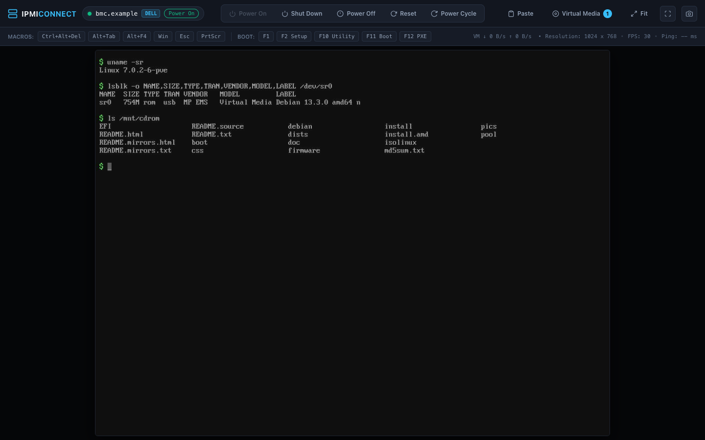
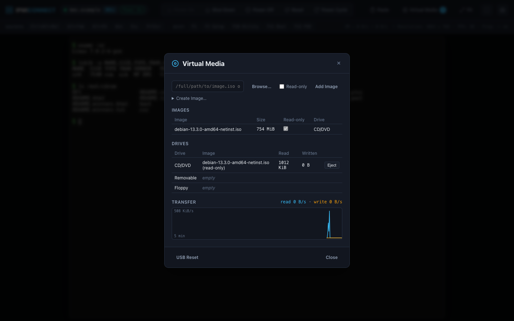
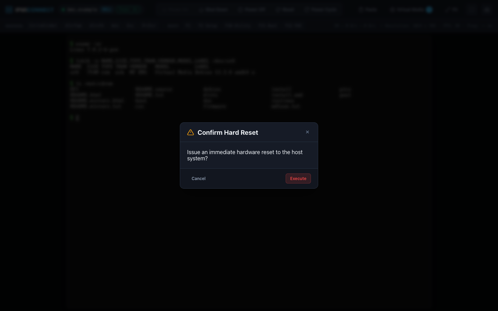

# ipmi-connect

A browser console for old Dell (Avocent) and Supermicro (ATEN) server BMCs, so you never have to fight Java Web Start again. One Go binary: video, keyboard, mouse, power control and virtual media, all in a normal browser tab.



## Why

I have a couple of older servers whose BMCs only offer a Java Web Start (`.jnlp`) remote console. Every time I needed the console I had to find yet another workaround to get an old Java running, with old TLS settings, just to see a screen. It irritated me enough to do something about it.

ipmi-connect talks to the BMCs' own KVM and virtual media protocols directly and shows the console in your browser. No Java, and no messing with browser TLS settings. It now works really well for me, virtual media included: I've booted OS installers over it.

## Screenshots

| Virtual media | Power control |
| :---: | :---: |
|  |  |

## Supported hardware

It has been tested on the two boards I own. Other BMCs running the same firmware families may work, but I can't promise anything.

| | Dell PowerEdge C6220 II | Supermicro X8DTL-6F |
| :--- | :--- | :--- |
| BMC | ASPEED AST2300, Avocent firmware 2.62.5 | Winbond WPCM450, ATEN firmware 3.13 |
| KVM protocol | Avocent APCP, two TLS sockets on 7578 | ATEN RFB 3.8 on 5900 |

| Feature | Dell | Supermicro |
| :--- | :--- | :--- |
| Login / clean logout | Works | Works |
| Live video | Works (Go ASPEED decoder, verified frame-for-frame against Aspeed's reference) | Works (Go Hermon decoder) |
| Keyboard | Works (USB HID) | Works (USB HID) |
| Mouse | Works | Works (absolute position and buttons verified on hardware) |
| Macros (Ctrl+Alt+Del, F-keys…) | Works | Implemented |
| Power control | Works | Status verified; commands over the KVM socket or `ipmi.cgi` |
| Virtual media | Works: ISO on CD/DVD (booted an installer), IMG on removable or floppy (read-write), Create Image, transfer graph, USB reset | Works: ISO on CD, IMG on removable or floppy (read-write), Create Image (blank or from a folder), all verified byte-exact on hardware; one drive at a time, see known issues |

The console also has typed paste (send your clipboard as keystrokes), screenshots, scaling and fullscreen with keyboard lock.

## How to run

You need Go 1.27.2 or newer.

```bash
go install github.com/mhamzahkhan/ipmi-connect/cmd/ipmi-connect@latest

export IPMI_CONNECT_PASSWORD='your BMC password'
ipmi-connect 192.0.2.10                     # logs in as root and opens the console in your browser
ipmi-connect 192.0.2.20 -u admin --no-browser   # just print the console link
```

Or build from a clone with `make build`, which writes `bin/ipmi-connect`.

The console runs at `http://127.0.0.1:8080` (or the next free port). The vendor is detected automatically; force it with `--type dell|supermicro`. Credentials come from flags, then environment variables, then defaults:

| | Flag | Environment | Default |
| :--- | :--- | :--- | :--- |
| User | `-u` | `IPMI_CONNECT_USER` | `root` |
| Password | `-p` | `IPMI_CONNECT_PASSWORD` | interactive prompt |

Prefer the environment variable or the prompt over `-p`, because flags are visible in the process list.

Press Ctrl+C to exit. ipmi-connect logs out of the BMC first, because the Dell allows only **one** console session; an unclean exit locks you out until the BMC times the session out.

## Use at your own risk

This is a hobby project, provided as is, with no warranty. If you use it, you do so at your own risk, and I'm not responsible for any damage or data loss it causes.

Be aware that it can power-cycle and reset servers, and that virtual media can write to disk images. Only use it on hardware you own or are allowed to manage, and try it on something unimportant first.

## Security

These BMCs predate modern TLS, so use ipmi-connect on a trusted management network.

- BMC certificates are not verified. The BMCs use self-signed certificates and TLS 1.0, so the client accepts any certificate. Someone who can intercept traffic between you and the BMC could see the web login, which carries your password.
- Supermicro KVM and virtual media are not encrypted. The screen and keystrokes travel in plain RFB (the firmware's "KVM SSL" mode is not supported), and virtual media uses RC4 under a fixed key published in the vendor client. Your password is not sent on these channels: they use one-time tickets from the web session.
- The local console listens on 127.0.0.1 only. API and WebSocket requests need a per-run token, obtained through the one-time code in the launch link, and cross-site requests are refused.

## How it was built

This was entirely vibe coded, and I'm not ashamed of it lol. Without AI it would never have got done.

I used two models and switched between them. I generally prefer Claude Opus 5.5 (in [Claude Code](https://claude.com/claude-code)), but I only have the Pro plan and kept running out of tokens, so I also used Gemini 3.8 Flash (in [Antigravity](https://antigravity.google)).

Gemini did the reverse engineering, using [REA](https://github.com/morluto/rea) to work out the protocols from the vendors' viewer applets and BMC firmware. Claude did the refining and optimising, and fixed the mistakes Gemini made.

Everything was tested against my own hardware, and the protocol notes are in [docs/](docs/README.md). No vendor code is included; see [NOTICE](NOTICE).

## Similar projects

Other tools do some of this, but none did everything I wanted: both of my boards, in a browser, with virtual media from local files.

| Project | What it does | Why it didn't fit |
| :--- | :--- | :--- |
| [smkvm](https://github.com/glennswest/smkvm) | Native macOS console for ATEN iKVM (X8/X9/X10) | macOS only; no virtual media |
| [modern-idrac-client](https://github.com/the-curve-consulting/modern-idrac-client) | Go client and console for Dell iDRAC6/7/8/9 | Targets iDRACs, which the C6220's BMC is not; no Supermicro |
| [idrac-6-rs](https://github.com/SeineEloquenz/idrac-6-rs) | Java-free iDRAC6 console via a VNC bridge | iDRAC6 only; no virtual media or power control |
| [idrac-kvmclient](https://github.com/Informatic/idrac-kvmclient) | Python iDRAC KVM client with a VNC proxy | iDRAC only; virtual media listed as missing |
| [noVNC ATEN fork](https://github.com/kelleyk/noVNC) | noVNC with ATEN iKVM support | Video and input only; last updated in 2017 |
| [chicken-aten-ikvm](https://github.com/thefloweringash/chicken-aten-ikvm) | macOS VNC viewer with ATEN iKVM support | macOS only; no virtual media |
| [drac-kvm](https://github.com/PaulMaddox/drac-kvm) | Launcher for Dell's Java viewers | Still needs Java |

## Future plans

- Load BMC credentials from HashiCorp Vault
- An easy way to switch between servers
- A hosted option: run it in a container on your network, sign in with OAuth, and connect to any of your BMCs from the browser
- Screen recording
- Serial over LAN (SOL)

## Contributing

PRs are welcome, especially support for other boards and firmware. Please run `make` (lint, race tests, build) before sending one.

```bash
make            # lint, test, build
make test       # go test -race ./...
make lint       # go vet + golangci-lint (config in .golangci.yml)
make fmt
```

Code layout:

```text
cmd/ipmi-connect/      CLI: flags, vendor detection, per-vendor setup and stream loops
internal/
  bmc/                 Shared types, legacy TLS 1.0 HTTP client, password prompt
  dell/                Avocent client: web session, APCP channels, heartbeat, video, input, power
  supermicro/          ATEN client: CGI session, RFB handshake and input, power
  web/                 Local HTTP/WebSocket server, key macros, frame broadcast
    static/            Embedded browser UI
  aspeed/              ASPEED video decoder (Go port of Aspeed's MPL-2.0 reference)
  vmedia/              Virtual media manager: local image library, drives, transfer stats
  avmp/                Dell (Avocent AVMP) virtual media client
  atenvm/              Supermicro (ATEN Virtual Storage) virtual media client
  diskimage/           FAT image creation (blank, or from a folder)
  textkeys/            Text to USB HID key presses (US layout)
docs/                  Hardware notes, protocol specs, per-vendor deep dives
```

## Known issues

- Supermicro: while the BMC's own web-UI media mount is active, it has one free virtual media slot, so a second drive is refused with "slots are full or busy".
- `--port` is accepted for compatibility but ignored.

## Credits

- [REA](https://github.com/morluto/rea), the agent-driven reverse-engineering toolkit used to work out the protocols
- Eclypsium's [USBAnywhere](https://github.com/eclypsium/USBAnywhere) research, whose published Supermicro virtual media capture gave the test vectors
- ASPEED's [aspeed_codec](https://github.com/AspeedTech-BMC/aspeed_codec), the reference video decoder the Go decoder is ported from
- The projects in [Similar projects](#similar-projects), used as references to cross-check protocol details (no code was copied)
- Libraries: [coder/websocket](https://github.com/coder/websocket), [go-diskfs](https://github.com/diskfs/go-diskfs) and [golang.org/x/term](https://pkg.go.dev/golang.org/x/term)

## License

Apache License 2.0; see [LICENSE](LICENSE) and [NOTICE](NOTICE). The ASPEED video decoder in `internal/aspeed/` is ported from Aspeed's reference implementation and stays under the Mozilla Public License 2.0; see [internal/aspeed/LICENSE](internal/aspeed/LICENSE).

ipmi-connect is an independent project, not affiliated with or endorsed by Dell, Vertiv (Avocent), ATEN, Supermicro or ASPEED. Their names are used only to describe compatibility; see [NOTICE](NOTICE) for the trademark details.
