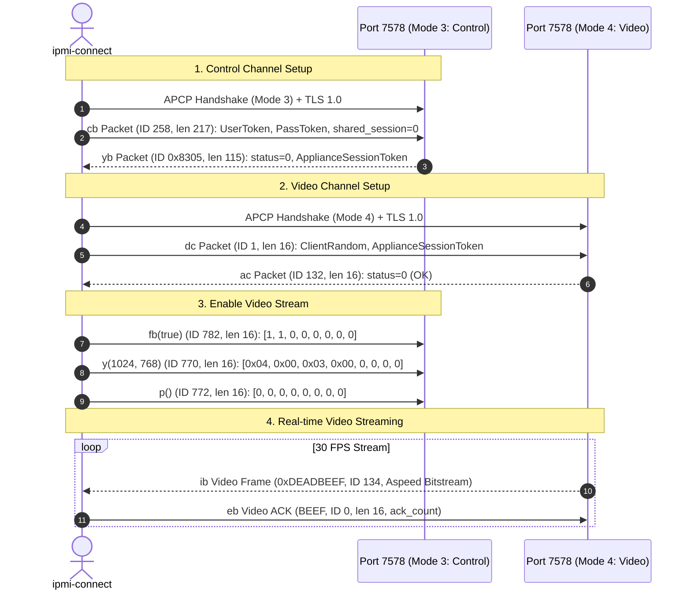

# Dell PowerEdge C6220 II Deep Dive

## System Profile

- **Device**: Dell PowerEdge C6220 II Node
- **BMC Hardware**: ASPEED AST2300 (ASIC Type 7)
- **BMC Firmware**: Version `2.62.5` (Build Date: May 21 2015 15:52:43)
- **Host BIOS**: Dell BIOS `2.10.0`
- **Firmware Vendor**: Avocent MergePoint Embedded Edition

---

## 1. Web Architecture & Authentication Peculiarities

### 1.1 Web Server & TLS Quirks
- **Web Server**: `Mbedthis-Appweb/2.4.2`
- **HTTPS Port**: `443`
- **Protocol**: **TLSv1.0 ONLY**. Modern browsers and modern OpenSSL/Go configurations disable TLS 1.0 by default.
- **Cipher Suite**: Requires `TLS_RSA_WITH_AES_256_CBC_SHA`, `TLS_RSA_WITH_AES_128_CBC_SHA`, or `TLS_RSA_WITH_3DES_EDE_CBC_SHA`.
- **Certificates**: Self-signed certificate issued to `Dell Inc.` / `Round Rock, Texas`.

### 1.2 Authentication & Session Flow
The BMC web server implements a two-step CSRF token mechanism:
1. `GET /index.html`: Returns initial page containing CSRF tokens:
   - `CSRF_TOKEN_1`: A parameter string like `ST1=00000000000000000000000000000000`
   - `CSRF_TOKEN_2_NAME`: Header key `ST2`
   - `CSRF_TOKEN_2_VALUE`: A hex string token
2. `POST /data/login`:
   - URL: `https://<bmc>/data/login`
   - Content-Type: `application/x-www-form-urlencoded`
   - Headers: `ST2: <token2>`
   - Body: `user=root&password=<escaped_password>`
   - **Password Escaping Quirk**: Avocent's `encodeSetValue()` escapes `\`, `:`, `,`, `(`, `)`, `=`, `&`, `?` with a preceding backslash `\`, followed by standard URL encoding.
   - Successful response: XML payload `<status>ok</status>` with updated `ST1` and `ST2` tokens in cookies / response XML.

### 1.3 CRITICAL: Session Limit & Mandatory Logout
> [!CAUTION]
> The ASPEED AST2300 BMC firmware allows a maximum of **1 concurrent GUI session**!
> If a client logs in without cleanly logging out, subsequent login attempts will be rejected with:
> `Login forbidden. A GUI session has been created and is active.` (Error code 6).
>
> **Every client must explicitly invoke logout upon exit or signal**:
> `GET https://<bmc>/data/logout?ST1=<ST1_TOKEN>`

---

## 2. Remote Console (vKVM) Launch Protocol

### 2.1 JNLP Token Generation
To obtain a one-time session key for the KVM engine, the client performs:
```http
GET https://<bmc>/viewer.jnlp(<bmc>@0@<UNIX_TIMESTAMP>)?ST1=<token>
```
The server responds with an XML JNLP containing the following parameters:
- `user`: One-time user token string (e.g. `1059961393`)
- `passwd`: One-time password token string (e.g. `2089018456`)
- `kmport`: `7578` (Keyboard/Mouse & Control port)
- `vport`: `7578` (Video console port)
- `apcp`: `1` (Avocent Proprietary Protocol enabled)

---

## 3. Avocent APCP Dual-Channel Wire Protocol (Port 7578)

Dell Avocent KVM requires **two concurrent TCP connections** to port 7578:
1. **Channel Mode 3 (Control & Input)**: Handles user authentication, video activation, keyboard inputs, and mouse coordinates.
2. **Channel Mode 4 (Video Console)**: Receives ASPEED compressed video bitstream frames and returns video ACKs.

### 3.1 Initial APCP Handshake (Both Channels)
Both connections initiate with a 53-byte `APCP` greeting packet:
- Bytes 0..3: ASCII `"APCP"` (`0x41 0x50 0x43 0x50`)
- Bytes 4..7: Total length (uint32 big-endian = `53`)
- Bytes 8..9: Message Type (uint16 big-endian = `0x0100`, Handshake Request)
- Bytes 10..11: Code (`0x0000`)
- Byte 12: Sub-channel Mode (`0x03` for Control Channel, `0x04` for Video Channel)
- Byte 13: Major Version (`0x02`)
- Byte 14: Minor Version (`0x22` = 34)
- Byte 15: Reserved (`0x00`)
- Bytes 16..19: Capabilities (`0x00000005`, bit 0=plain, bit 2=SSL/TLS)
- Byte 20: Nonce Length (`32`)
- Bytes 21..52: Random Client Nonce (32 bytes)

The BMC responds with 53 bytes (`APCP`, type `0x8100`). Both channels are immediately upgraded to TLS 1.0 (`TLS_RSA_WITH_AES_256_CBC_SHA`).

---

## 4. Dual-Channel Authentication Sequence



### 4.1 Packet Specifications

#### `cb` Packet (Control Authentication - ID 258 / 0x0102)
- Total Length: 217 bytes (8-byte BEEF header + 209-byte payload)
- Payload Byte 0: `len(userToken)`
- Payload Bytes 1..96: `userToken` UTF-8 string padded to 96 bytes
- Payload Byte 97: `len(passToken)`
- Payload Bytes 98..193: `passToken` UTF-8 string padded to 96 bytes
- Payload Bytes 194..201: 8 zeroes
- Payload Byte 202: Port (`1`)
- Payload Byte 203: Channel (`0`)
- Payload Bytes 204..207: Client Random uint32 (big-endian)
- Payload Byte 208: `shared_session` flag: **MUST BE 0**! (If set to 1, BMC rejects with status 3 "Failed to open video connection").

#### `yb` Packet (Control Auth Response - ID 0x8305)
- Header: Magic `"BEEF"`, Packet ID `0x8305`, Total Length `115`
- Payload Byte 0: Status code (`0` = Success)
- Payload Bytes 4..7: `ApplianceSessionToken` uint32 big-endian

#### `dc` Packet (Video Authentication - ID 1)
- Total Length: 16 bytes (8-byte BEEF header + 8-byte payload)
- Payload Bytes 0..3: Client Random uint32 (must match `cb` packet)
- Payload Bytes 4..7: `ApplianceSessionToken` received from `yb` packet

#### `ac` Packet (Video Auth Response - ID 132 / 0x0084)
- Length: 16 bytes. Payload Byte 0 == `0` (Success).

---

## 5. ASPEED Video Engine (AST2300) Stream Decoding

### 5.1 Video Packet Framing
Video packets are framed with **Magic `0xDEADBEEF`** (`0xDE 0xAD 0xBE 0xEF`), Packet ID **134** (`0x0086`, `ib` packet).

Packet Payload Structure:
- Byte 0: Mode (e.g. `5`). `mode420 = Mode & 1` (`1` = YUV420, `0` = YUV444)
- Bytes 1..3: Packed 12-bit tile coordinates:
  - `n3 = (b[1]<<16) | (b[2]<<8) | b[3]`
  - `X = (n3 >> 12) & 0xFFF`
  - `Y = n3 & 0xFFF`
- Bytes 4..5: Tile Height (rows, e.g. `400` in BIOS text mode)
- Bytes 6..7: Tile Width (columns, e.g. `720` in BIOS text mode)
- Byte 8: Flags:
  - Bit 0 (`0x01`): `isFirstChunk` (start of new frame)
  - Bit 1 (`0x02`): `isUpdate`
- Byte 11: Quantization table selectors:
  - `selector = b[11] & 0x0F`
  - `advance_selector = (b[11] >> 4) & 0x0F`
- Bytes 12..: ASPEED compressed bitstream bytes.

### 5.2 Video ACK (`eb` Packet - ID 0)
For every video packet received on Channel 4, the client must reply with an `eb` packet:
- Header: `"BEEF"` + `uint16(0)` + `uint16(16)`
- Payload: `[1, 0, 0, 0, 0, 0, 0, 0]`: byte 0 is a batch count and is always `1` (see §8.6)
Without this ACK, the AST2300 hardware video engine halts streaming after 1-2 frames.

### 5.3 Frame Assembly & Decoder
1. Chunks with `isFirstChunk = true` indicate the beginning of a frame. Continuation chunks (`isFirstChunk = false`) are appended.
2. Complete frames go to Aspeed's JS decoder (`decoder_js.js`, patched to take separate luma and chroma table selectors), which decompresses the AST2300 VQ/DCT stream to RGBA32 pixels for the HTML5 `<canvas>`. Each frame updates the whole screen from the origin; byte 11's high nibble selects the luma table and its low nibble the chroma table.

---

## 6. Remote Input Injection (Control Channel)

Keyboard and mouse inputs are injected directly into Channel Mode 3 (Control Channel):

### 6.1 Mouse Packet (ID 513 / 0x0201 - `jc.java`)
- Header: `"BEEF"` + `uint16(513)` + `uint16(16)`
- Payload (8 bytes):
  - Byte 0: `0`
  - Byte 1: Button mask (`1` = Left, `2` = Middle, `4` = Right)
  - Bytes 2..3: X coordinate (uint16 big-endian)
  - Bytes 4..5: Y coordinate (uint16 big-endian)
  - Bytes 6..7: Wheel / delta (uint16 big-endian)

### 6.2 Keyboard Packet (ID 512 / 0x0200 - `e.java`)
- Header: `"BEEF"` + `uint16(512)` + `uint16(16)`
- Payload (8 bytes):
  - Byte 0: `0`
  - Byte 1: Key state (`0` = Pressed / Down, `1` = Released / Up)
  - Bytes 2..3: Standard USB HID Key Code (uint16 big-endian)
  - Bytes 4..7: 4 zero bytes

---

## 7. Power Control & Session Keepalive API

### 7.1 Chassis Power Control API
Chassis power control requires an **HTTP POST** request with an empty body and strict query parameter ordering:
```http
POST https://<bmc>/data?ST1=<ST1_TOKEN>&set=pwState:<CODE>
Content-Type: application/x-www-form-urlencoded
ST2: <ST2_TOKEN>
```

> [!IMPORTANT]
> **Query Parameter Ordering**: The `ST1` token parameter **MUST precede** `set=pwState:<CODE>`. If `set=...` appears first (e.g. `data?set=pwState:3&ST1=...`), the AppWeb query parser fails to split the parameters correctly and returns:
> ```xml
> <root><status>RequestFormatException</status><errorMsg>Bad request format</errorMsg></root>
> ```
> When formatted as `data?ST1=<token>&set=pwState:<CODE>`, the BMC responds with `<root><status>ok</status></root>`.

#### Valid Power Action Codes:
- `0`: Power Off (Immediate hardware power cut)
- `1`: Power On (Chassis power up)
- `2`: Power Cycle (Power off followed by power on)
- `3`: Hard Reset (Immediate motherboard hardware reset)
- `4`: Diagnostic Interrupt (NMI)
- `5`: Graceful ACPI shutdown

These follow the IPMI Chassis Control command codes. The KVM viewer's own power menu uses a separate control-channel packet (ID 1060, `SetPowerState`) with different numbering: 1 On, 2 Off, 3 Cycle, 4 Reboot, 5 Graceful Shutdown.

### 7.2 Session Keepalive Endpoint
To prevent the AppWeb WebGUI session from expiring (~45-60 second idle timeout), send periodic keepalive heartbeats:
```http
POST https://<bmc>/data/keepGUISessionAlive?ST1=<ST1_TOKEN>
Content-Type: application/x-www-form-urlencoded
ST2: <ST2_TOKEN>
```
Response:
```xml
<?xml version="1.0" encoding="UTF-8"?><root> <alive /> <status>ok</status></root>
```

### 7.3 Power Status Query
Chassis power state can be read via:
```http
POST https://<bmc>/data?ST1=<ST1_TOKEN>&get=pwState,
Content-Type: application/x-www-form-urlencoded
ST2: <ST2_TOKEN>
```
*(Note the mandatory trailing comma in `pwState,`)*
Response:
```xml
<root><pwState>1</pwState><status>ok</status></root>
```
Where `1` = System Powered ON, `0` = System Powered OFF.

---

## 8. Video Stream Persistence & Heartbeats

### 8.1 60-Second Video Channel Timeout
The AST2300 Avocent hardware video engine enforces an idle socket timeout of **60 seconds**. When the host display is completely static (e.g. at a boot prompt, BIOS screen, or grub menu), the ASPEED compression engine stops generating bitstream packets on Channel Mode 4. Once 60 seconds elapse with zero traffic, the BMC tears down the TCP socket.

### 8.2 Video Refresh Heartbeat (Packet 772 / `p`)
To maintain continuous video streaming without connection drops:
- Send Packet 772 (`p` / full screen refresh) on the **Control Channel** (Mode 3) whenever no video packets have been received for 15 seconds:
  ```
  Magic: "BEEF" (0x42 0x45 0x45 0x46)
  Packet ID: 772 (0x0304)
  Length: 16 (0x0010)
  Payload: 8 zero bytes
  ```
- Receiving this packet prompts the AST2300 hardware engine to immediately generate a fresh full-frame bitstream chunk on Channel Mode 4, continuously resetting the 60-second idle timer.

### 8.3 Transparent Automatic Reconnect
If the connection is interrupted for any external reason (e.g. host reset, resolution change, network hiccup):
1. The video streamer catches `io.EOF` or socket errors without exiting.
2. The client re-acquires fresh one-time JNLP tokens (`viewer.jnlp`).
3. Re-establishes Channel Mode 3 (Control) and Mode 4 (Video).
4. Re-enables video streaming via packets `fb`, `y`, and `p`.
5. Frame streaming resumes seamlessly within 2-3 seconds with zero manual intervention.

### 8.4 Control Channel Watchdog & Packet 1024 (`q` Heartbeat)
- **The 30-Second Inactivity Watchdog**: The Dell AST2300 BMC firmware implements an aggressive 30-second watchdog on Channel Mode 3 (Control). If no packet is received for 30 seconds, the BMC closes the Control Channel with `EOF`, which subsequently terminates the KVM session and video streaming.
- **Heartbeat Packet 1024 (`q`)**: To defeat the watchdog, the client sends Packet 1024 every 5 seconds on the Control Channel:
  ```
  Magic: "BEEF" (0x42 0x45 0x45 0x46)
  Packet ID: 1024 (0x0400)
  Length: 16 (0x0010)
  Payload: 8 zero bytes
  ```
- **Control Channel Drain**: The client also runs a background goroutine continuously reading from `CtrlConn` to drain capability packets (`0x8430`, `0x8410`, etc.) and prevent TCP receive buffer exhaustion.

### 8.5 Safe Framing Read Timeout Rule
- Setting deadlines on multi-byte `io.ReadFull(conn, header)` calls over TLS is dangerous. If a read times out mid-header after consuming 1-3 bytes, the stream loses alignment permanently, producing `unexpected video frame magic 0x00000090`.
- To avoid desynchronization:
  1. Read only the 1st byte (`frameHeader[:1]`) using the caller's idle timeout.
  2. If it times out, 0 bytes have been consumed and the TCP buffer remains aligned.
  3. Once the 1st byte arrives, extend the deadline to a full 3 seconds to read the remaining 7 header bytes and the complete payload.

### 8.6 Video ACK (`eb`) Batch Count Mechanics
- On Channel Mode 4, the client must acknowledge received video packets with packet `eb` (ID 0).
- Payload byte 0 is the batch count of processed packets (`1`), **not** a sequence number. Sending `c.AckCount & 0xFF` causes packet 256 to send `0`, which halts the AST2300 transmission engine. Always send `1`.

### 8.7 Aspeed YUV2RGB Alpha Masking & Canvas Resizing
- **Alpha Opacity**: The ASPEED bitstream encodes only YUV data. Decoders (both WASM and pure JS) must explicitly set the alpha channel to full opacity (`A = 255` / `|= 0xFF000000`), otherwise the HTML5 canvas blends the image into transparent/washed-out grey.
- **Canvas Resize Guard**: HTML5 canvas clears its entire buffer whenever `canvas.width` or `canvas.height` is assigned. To prevent small tile updates (e.g., cursor blinks at `(0, 0)` with width 14 and height 16) from wiping the screen, only resize the canvas when `w >= 320 && h >= 200`.

### 8.8 Washed-out picture: a decoder bug, not an analog offset
Earlier versions saw black decoded at ~101 and white at ~134 and blamed an analog VGA ADC
pedestal, correcting it with an auto-contrast LUT in the browser. Testing on the C6220 showed
the real cause: byte 11 of each `ib` packet carries the **luma** quantisation table in its high
nibble and the **chroma** table in its low nibble (this BMC uses luma 4, chroma 7), and the client
was decoding with the chroma table only. Decoding the same live stream both ways:

| Decode | Black level (1st percentile luma) |
| :--- | :--- |
| Chroma table for everything (old) | 101 |
| Luma 4 / chroma 7 (correct) | 6 |

The auto-contrast LUT's guard only engages when black sits above 30, so with correct decoding it
stays inactive. It remains in the UI for now and is a candidate for removal.
