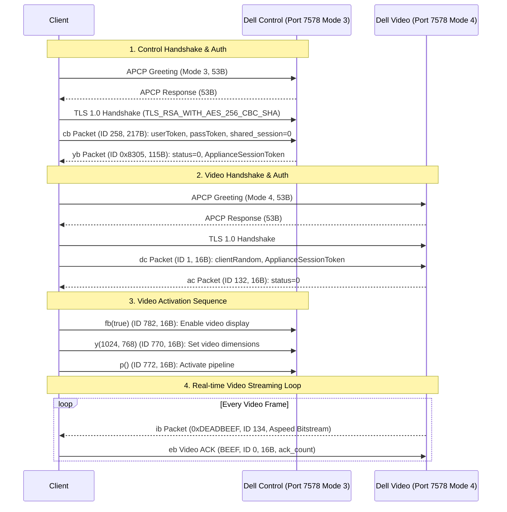

# IPMI Wire Protocol Specifications

This document defines the wire-level packet structures, opcodes, and sequence diagrams for the proprietary protocols used by Dell (Avocent) and Supermicro (ATEN) BMCs.

---

## 1. Dell Avocent APCP Protocol (Port 7578)

The Avocent Proprietary Communication Protocol (APCP) operates over **TCP Port 7578** and requires **two concurrent sockets**:
- **Socket 1 (Control & Input)**: Handshake channel mode `0x03`
- **Socket 2 (Video Stream)**: Handshake channel mode `0x04`

### 1.1 Dual-Channel Connection & Activation Sequence



### 1.2 Handshake Packet Byte Map (53 Bytes)

| Offset | Type | Field Name | Description |
| :---: | :---: | :--- | :--- |
| `0x00 - 0x03` | `char[4]` | `Magic` | ASCII string `"APCP"` (`0x41 0x50 0x43 0x50`) |
| `0x04 - 0x07` | `uint32` (BE) | `Length` | Packet length (`0x00000035` = 53 bytes) |
| `0x08 - 0x09` | `uint16` (BE) | `MessageType` | `0x0100` (Handshake Request) |
| `0x0A - 0x0B` | `uint16` (BE) | `Code` | Reserved (`0x0000`) |
| `0x0C` | `uint8` | `ChannelMode` | `0x03` = Control / Auth / Input, `0x04` = Video KVM Console |
| `0x0D` | `uint8` | `MajorVersion` | `0x02` (Client major version) |
| `0x0E` | `uint8` | `MinorVersion` | `0x22` = 34 (Client minor version) |
| `0x0F` | `uint8` | `Reserved` | `0x00` |
| `0x10 - 0x13` | `uint32` (BE) | `Capabilities` | Bit 0: Plain (`1`), Bit 2: TLS (`4`) -> `0x00000005` |
| `0x14` | `uint8` | `NonceLength` | `0x20` = 32 bytes |
| `0x15 - 0x34` | `byte[32]` | `ClientNonce` | 32 cryptographically random bytes |

### 1.3 Control Channel Authentication (`cb` Packet - ID 258)
- Total length: 217 bytes.
- Header: Magic `"BEEF"` (4 bytes), ID `0x0102` (258, 2 bytes), Length `217` (2 bytes).
- Payload:
  - Byte 0: `len(user)`
  - Bytes 1..96: UTF-8 user token string (padded to 96 bytes)
  - Byte 97: `len(password)`
  - Bytes 98..193: UTF-8 password token string (padded to 96 bytes)
  - Bytes 194..201: 8 zero bytes
  - Byte 202: Port (`1`)
  - Byte 203: Channel (`0`)
  - Bytes 204..207: Client random uint32 BE
  - Byte 208: `shared_session` flag: **MUST BE 0**!

### 1.4 Video Channel Authentication (`dc` Packet - ID 1)
- Total length: 16 bytes.
- Header: Magic `"BEEF"`, ID `0x0001` (1), Length `16`.
- Payload:
  - Bytes 0..3: Client random uint32 BE (matching `cb` packet)
  - Bytes 4..7: `ApplianceSessionToken` from `yb` packet response

### 1.5 Video Stream Framing (`ib` Packet - ID 134)
- **Magic**: `0xDEADBEEF` (`0xDE 0xAD 0xBE 0xEF`)!
- Packet ID: `0x0086` (134)
- Payload:
  - Byte 0: Mode (e.g. `5`). `mode420 = Mode & 1` (`1` = YUV420, `0` = YUV444)
  - Bytes 1..3: Packed 12-bit tile coordinates (`X = n3 >> 12 & 0xFFF`, `Y = n3 & 0xFFF`)
  - Bytes 4..5: Tile Height (rows)
  - Bytes 6..7: Tile Width (columns)
  - Byte 8: Flags (bit 0 = `isFirstChunk`, bit 1 = `isUpdate`)
  - Byte 11: Quantization table selectors (`selector = b & 0x0F`, `adv_selector = (b >> 4) & 0x0F`)
  - Bytes 12..: ASPEED compressed bitstream bytes

### 1.6 Video ACK (`eb` Packet - ID 0)
- Sent on Video Channel for each received video packet (`ib`).
- Header: `"BEEF"` + `uint16(0)` + `uint16(16)`
- Payload: `[0x01, 0, 0, 0, 0, 0, 0, 0]`
- **Quirk**: Payload byte 0 is the batch count of acknowledged packets (`1`), **not** a cumulative sequence counter. If treated as a cumulative counter modulo 256, sending `0` on the 256th packet causes the AST2300 engine to pause/stall.

### 1.7 Control Channel Heartbeat (`q` Packet - ID 1024 / `0x0400`)
- **CRITICAL WATCHDOG PREVENTION**: The AST2300 Avocent BMC firmware runs a strict 30-second inactivity watchdog on Channel Mode 3 (Control). If no packet is received for 30 seconds, the BMC sends EOF and terminates the entire KVM session and video stream.
- Sent every 5 to 10 seconds on the **Control Channel** (Mode 3):
  - Header: `"BEEF"` + `uint16(1024)` (`0x0400`) + `uint16(16)`
  - Payload: `[0, 0, 0, 0, 0, 0, 0, 0]` (8 zero bytes)
- In addition, the client must continuously read from the Control Channel in the background to drain capability and status notifications emitted by the BMC.

### 1.8 Video Frame Refresh (`p` Packet - ID 772 / `0x0304`)
- Header: `"BEEF"` + `uint16(772)` (`0x0304`) + `uint16(16)`
- Payload: `[0, 0, 0, 0, 0, 0, 0, 0]` (8 zero bytes)
- Direction: Client -> Control Channel (Mode 3)
- Purpose: Sent upon client connection or when the host screen has remained static for 15s. Forces the ASPEED AST2300 hardware video engine to emit a fresh full-frame bitstream chunk on Mode 4, preventing the 60-second idle disconnect on static BIOS screens.

### 1.9 Safe TCP Framing Over TLS
When framing packets over TCP/TLS (`BEEF` / `0xDEADBEEF` headers):
- **Never** set a timeout directly on `io.ReadFull(conn, header)` for a multi-byte header. If a timeout occurs after reading 1-3 bytes, those bytes are permanently discarded, offsetting the 8-byte framing on subsequent reads (`unexpected video frame magic 0x00000090`).
- **Safe Framing Rule**: Read the 1st byte with the caller's idle timeout. If it times out, 0 bytes were consumed and stream alignment is preserved. Once the first byte arrives, extend the deadline to a generous 3 seconds to read the remaining 7 header bytes and the payload.

### 1.10 Frame Reassembly & Alpha Channel
- **Multi-packet Chunking**: The AST2300 splits large frames (e.g. 720x400 full frame = 19,056 bytes) across multiple `ib` packets (e.g., Pkt 0: 8192 bytes, Pkt 1: 3568 bytes, Pkt 2: 7296 bytes).
- **Boundary Detection**: `pkt.Flags & 1 != 0` indicates the start of a new frame. When accumulating continuation chunks (`pkt.Flags & 1 == 0`), an adaptive 40ms read timeout safely identifies the end of the frame without relying on fragile packet size heuristics.
- **Alpha Masking**: The ASPEED hardware bitstream only encodes YUV luminance/chrominance channels. The software decoder must explicitly enforce full opacity (`A = 255` / `|= 0xFF000000`), or the HTML5 canvas renders translucent pixels that blend into dark grey backgrounds.

### 1.11 Remote Input (Control Channel)
- **Mouse (`jc`, ID 513 / 0x0201)**:
  - Header: `"BEEF"` + `uint16(513)` + `uint16(16)`
  - Payload: `[0, button_mask, X_hi, X_lo, Y_hi, Y_lo, wheel_hi, wheel_lo]`
- **Keyboard (`e`, ID 512 / 0x0200)**:
  - Header: `"BEEF"` + `uint16(512)` + `uint16(16)`
  - Payload: `[0, isDown ? 0 : 1, hidCode_hi, hidCode_lo, 0, 0, 0, 0]` (Standard USB HID key codes)

### 1.12 Dell AppWeb HTTP Power Control & Session Management
- **Power Action (`POST /data?ST1=<token>&set=pwState:<CODE>`)**:
  - Crucial requirement: `ST1` CSRF token MUST precede `set=pwState:...` in the URL query string.
  - Header: `Content-Type: application/x-www-form-urlencoded`
  - Header: `ST2: <token>`
  - Body: empty string (`""`)
  - Codes (IPMI Chassis Control): `0` = Off, `1` = On, `2` = Power Cycle, `3` = Hard Reset, `4` = NMI, `5` = ACPI Shutdown
- **Session Keepalive (`POST /data/keepGUISessionAlive?ST1=<token>`)**:
  - Prevents the AppWeb WebGUI session from timing out.
  - Header: `Content-Type: application/x-www-form-urlencoded`, Header: `ST2: <token>`.
- **Power State Polling (`POST /data?ST1=<token>&get=pwState,`)**:
  - Returns `<root><pwState>1</pwState><status>ok</status></root>`. Mandatory trailing comma on `pwState,`.

---

## 2. Supermicro ATEN iKVM (modified RFB, port 5900)

Sources: the X7SB3's own client library (`iKVM__V1.69.21`, decompiled), cross-checked with smkvm,
noVNC's ATEN fork and chicken-aten. Where they disagree, the vendor library for this firmware wins.

### 2.1 Getting a session

1. `POST /cgi/login.cgi` with `name=<user>&pwd=<password>` → `SID` cookie. A body containing
   `login_alert` means the login failed.
2. `GET /cgi/url_redirect.cgi?url_name=ikvm&url_type=jwsk` (fallback `url_name=man_ikvm`) with
   `Cookie: SID=…` → a JNLP. Its arguments are anchored on the host argument: host, **one-time
   token**, the same token, unused, KVM port. Firmware with "KVM SSL" adds `1` and a TLS port.
   Tokens are single use: fetch a new JNLP for every connection.
3. `GET /cgi/logout.cgi` ends the web session **and kicks the KVM session**, so log out last.

### 2.2 Handshake

```mermaid
sequenceDiagram
    participant C as Client
    participant B as BMC :5900
    B-->>C: "RFB 003.008\n"
    C->>B: same 12 bytes
    B-->>C: u8 n, n security types (0x10 = ATEN)
    C->>B: 0x10 (else the last type offered)
    B-->>C: 24-byte challenge (ignored)
    C->>B: token[24] ‖ token[24], NUL-padded, max 23 chars each
    B-->>C: u32 result (0 = OK; else u32 len + reason)
    C->>B: ClientInit 0x00
    B-->>C: ServerInit + 12-byte ATEN trailer
    C->>B: 0x37 (mouse info), full FramebufferUpdateRequest
```

The ServerInit width, height and pixel format are placeholders. The trailer is 4 unused bytes, a
u32 session id, and four flags: video allowed, keyboard/mouse allowed, kick allowed, virtual
media allowed. The client never sends SetPixelFormat or SetEncodings.

### 2.3 Server messages

| Type | Body |
| :--- | :--- |
| `0x00` | FramebufferUpdate: pad, u16 count, then per rect u16 x, y, w, h, s32 encoding, u32 frame mode, u32 length, data |
| `0x04` | Cursor: five u32 (x, y, w, h, type); type 1 adds a u32 and a w×h×2 bitmap |
| `0x16` | Keep-alive, 1 byte |
| `0x33` | 4 bytes |
| `0x35` | Keyboard info (2) + mouse info (3) |
| `0x37` | Mouse info: encryption flag, mouse mode, power status (3 bytes on this firmware, 2 on later X9) |
| `0x39` | Privilege notice: u32 a, u32 b, 256-byte text; a=1, b=4 means another user has control |
| `0x3c` | Two u32 |

The rect width and height are the live resolution. `0xFD80×0xFE20` means the host has no video
signal; the BMC answers every update request instantly in that state, so do not reply, poll at
1 Hz instead. A 1×1 rect means another session holds the video.

### 2.4 Hermon video (encoding 0x59, or 0x00 on older firmware)

10-byte header: type (1 = raw full frame, else tiles), depth (0 = RGB555 little-endian, 2 bytes per
pixel; non-zero = RGB222, 1 byte per pixel), u32 BE tile count, u32 BE total length. Each tile is
4 unused bytes, row, column, then 16×16 pixels, placed at (col×16, row×16) and clipped at the
edges. Request the next update (`03 01 0000 0000 w h`) after each one received.

### 2.5 Client messages

All input messages are 18 bytes:

- **Key:** `04 00 down 00 00 <u32 BE USB HID usage> 00×9`.
- **Pointer:** `05 00 buttons <u16 x> <u16 y> 00×11` (left 1, middle 2, right 4, wheel 8/16).
  When the 0x37 reply sets the encryption flag, send `05 01` plus one AES-128-CBC block of
  `[buttons, x, y, 11 random bytes]`, key `2b7e151628aed2a6abf7158809cf4f3c`, IV `00…0f`.
- **Keep-alive:** `16 01` every 3 s.
- **Power:** `1a n` (0 off, 1 on, 2 reset, 3 soft off). Without a KVM session, use
  `POST /cgi/ipmi.cgi` with `POWER_INFO.XML=(1,N)` (IPMI chassis codes: 0 off, 1 on, 2 cycle,
  3 reset, 5 soft). `POWER_INFO.XML=(0,0)` returns `<POWER STATUS="ON"/>`.
